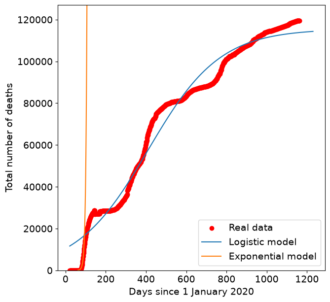

# A logistic and exponential model comparison applied to Covid-19

This is simple mathematical analysis of the infection growth to predict the
evolution of the coronavirus. The data collection used for this purpose is publicly
available as open data on github: 

- https://github.com/CSSEGISandData/COVID-19

Read the Johns Hopkins CSSE data repository terms of use for more information.


*Spain, 03-17-2020*

## Requirements

- Python 3.12 (pinned in `.python-version`)
- [uv](https://docs.astral.sh/uv/) (recommended) or `pip` with a virtualenv

## Installation

### With uv (recommended)

```bash
uv sync
```

This creates the `.venv` virtual environment and installs every dependency from
the lockfile (`uv.lock`), guaranteeing reproducible installs.

### With pip

```bash
python -m venv .venv
source .venv/bin/activate      # Linux/macOS
pip install -r requirements.txt
```

## Usage

Start Jupyter Notebook and open `pred.ipynb`:

```bash
uv run jupyter notebook pred.ipynb
```

Or, if you installed the environment with `pip`:

```bash
jupyter notebook pred.ipynb
```

The notebook downloads the latest COVID-19 daily reports from the Johns Hopkins
CSSE repository, fits both a logistic and an exponential model to the number of
deaths for the selected country (default: `Spain`) and plots the comparison,
together with the mean squared error (residuals) of each model.

## Managing dependencies

```bash
uv add <package>      # add a dependency
uv remove <package>   # remove a dependency
```

After changing dependencies, regenerate the pip-compatible `requirements.txt`:

```bash
uv export --format requirements-txt --no-hashes -o requirements.txt
```
